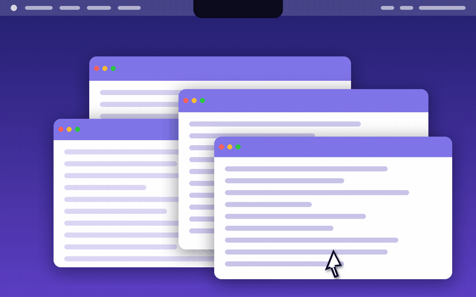

<p align="center"></p>

<h1 align="center">NotchPeek</h1>

<p align="center">Touch the notch with your cursor to open Mission Control.</p>

---

NotchPeek is a tiny menu bar app for macOS. Push your cursor up into the camera notch at the top of your MacBook screen and Mission Control opens. On screens without a notch, a strip at the top center works the same way.

## Install

1. Download **NotchPeek-1.0.dmg** from [Releases](https://github.com/vrlegacy/notchpeek/releases).
2. Open it and drag **NotchPeek** into **Applications**.
3. Open NotchPeek. The first time, macOS may warn about an unidentified developer: right-click the app, choose **Open**, then **Open** again.

## Use

Look for the NotchPeek icon in the menu bar. From there you can:

- turn it **on or off**
- choose a **Trigger Delay** (Instant, Short, Medium, Long) so it doesn't fire by accident
- turn **Launch at Login** on or off
- **Quit**

## Requirements

macOS 12 Monterey or later, on Apple silicon or Intel.

## Build from source

Needs Xcode Command Line Tools (`xcode-select --install`).

```bash
git clone https://github.com/vrlegacy/notchpeek.git
cd notchpeek
bash build.command
```

This builds `NotchPeek.app`, installs it in Applications, starts it, and makes `dist/NotchPeek-1.0.dmg`.

## License

MIT © 2026 Vishwas
